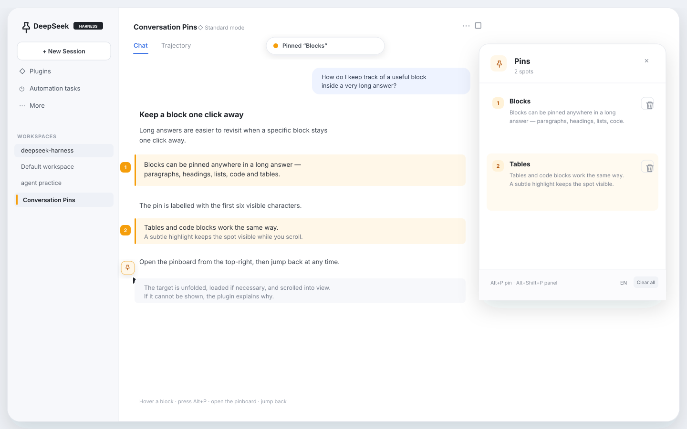
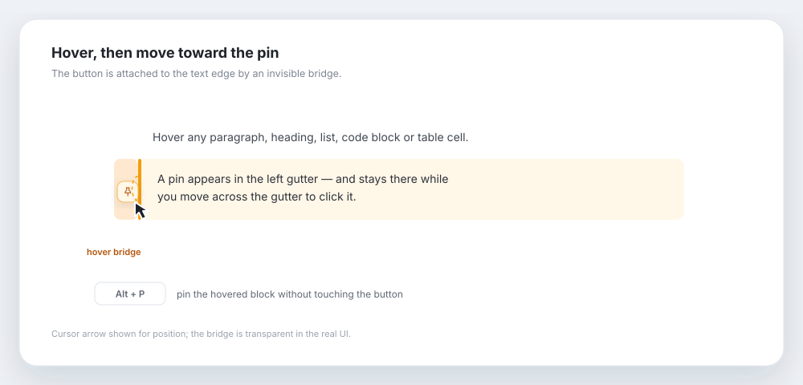
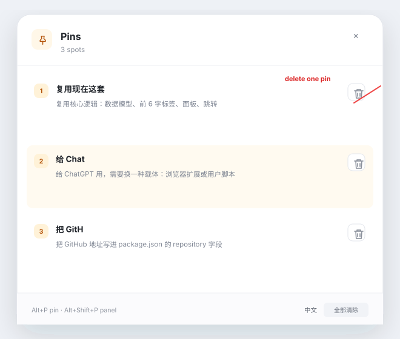
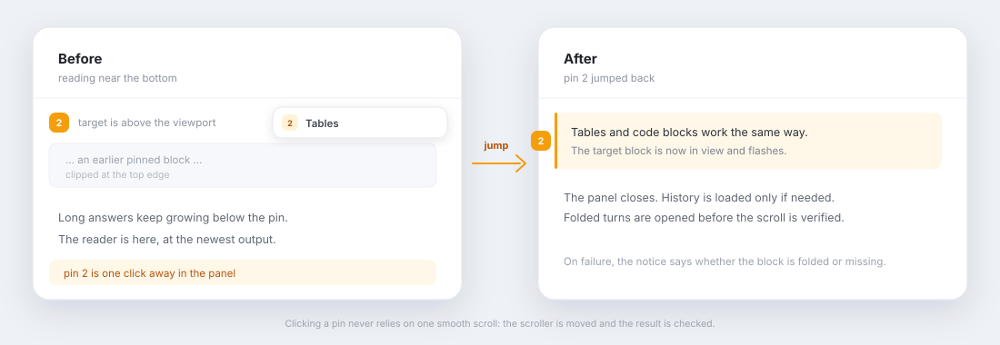

# Conversation Pins

[](https://github.com/mango2630/dsh-conversation-pins/actions/workflows/check.yml)
[](https://github.com/mango2630/dsh-conversation-pins/releases)
[](LICENSE)

English | [简体中文](README.zh.md)

Pin any block of a DeepSeek Harness conversation and jump back to it later. Long threads stop being a scroll hunt.

Conversation Pins is a **DeepSeek Harness Web / Desktop client plugin**. It adds a small pin control to rendered output, a numbered marker rail, and a per-session pinboard. It is not a ChatGPT plugin and cannot be installed into ChatGPT's own transcript.

## Preview



**Hover, then move to the pin**



**Pinboard and per-pin delete**



**Jumping from the bottom back to a pin**



*Clicking a pin moves the conversation scroller, expands folded content when needed, and verifies the target is visible.*

*Illustrations use synthetic content. The real UI follows the active DSH theme and locale.*

## Features

- **Pin any rendered block** — paragraphs, headings, list items, quotes, code blocks, and table cells.
- **Hover without losing the target** — the pin button is connected to the block's left edge by an invisible hover bridge, so moving from text to the button does not dismiss it.
- **Keyboard-first** — hover a block and press `Alt + P` to pin it. Press `Alt + Shift + P` to toggle the pinboard.
- **Six-character labels** — each pin is named from the first six visible characters, with grapheme-aware truncation for CJK and emoji.
- **Numbered markers** — pinned blocks are softly highlighted and marked in the transcript gutter.
- **Per-pin delete** — every pinboard row has a visible delete control, separate from the clear-all action.
- **Long-thread jumps** — the pinboard scrolls back to the block, loads older history only when needed, expands folded turns when possible, and verifies that the target actually landed in view.
- **Per-session storage** — pins are stored in `localStorage`, separated by `sessionId`; switching sessions does not mix them.
- **Bilingual UI** — follows the DSH locale and can be switched between 中文 and English from the panel.

## Requirements

- DeepSeek Harness `>=0.2.0 <0.3.0`, Web or Desktop profile.
- A Chat view. Trajectory view is not supported yet.

## Install

### Desktop app

The Desktop profile is managed by the Electron app; do not use `dsh plugin --profile desktop`.

1. Open **Plugins → Add plugin**.
2. Enter this repository's local path, a tarball path, or its GitHub address after you publish it.
3. Choose **Install**, then **Enable now**.
4. Fully quit and reopen DeepSeek Harness.

### Web / CLI

```sh
# From a local clone
dsh plugin --profile web add /path/to/dsh-conversation-pins

# Or from a packed tarball
pnpm pack
dsh plugin --profile web add ./dsh-conversation-pins-0.1.3.tgz
```

Restart `dsh web` afterwards. Verify the layer with:

```sh
dsh --profile web --dump-config | grep -A2 conversation-pins
```

Remove it with:

```sh
dsh plugin --profile web remove dsh-conversation-pins
```

Git installs work without a build step because `lib/` is committed:

```sh
dsh plugin --profile web add github:mango2630/dsh-conversation-pins
```

Push a tag such as `v0.1.2` to let the release workflow build and attach a tarball to the GitHub release.

## Usage

1. Hover over a piece of output.
2. Click the pin in the left gutter, or press `Alt + P`.
3. Keep reading or scroll to the bottom.
4. Open the pinboard from the button at the top-right of the conversation.
5. Click a pin to jump back; the panel closes and the target flashes.

| Action | Shortcut |
| --- | --- |
| Pin the hovered block | `Alt + P` |
| Open / close the pinboard | `Alt + Shift + P` |
| Close the pinboard | `Esc` |
| Jump to a pin | Click its list item or numbered marker |

Pins are browser-local. Clearing site data removes them. The storage keys are `dsh:conversation-pins:v1:<sessionId>` and `dsh:conversation-pins:language`.

## How jumps work

A pin stores the conversation node key, block index, a text prefix, the owning turn, and the node's anchor sequence. Jumping prefers the currently rendered DOM; it only calls `Session.loadThrough(anchorSeq)` when the block is not loaded. It then scrolls the conversation scroller directly, checks the target's viewport position, and falls back to an instant correction if a smooth scroll was interrupted. If the target sits inside a folded turn or process group, the plugin tries to open the relevant disclosures first. If it still cannot make the block visible, it reports whether the content is folded or missing instead of failing silently.

## Limits

- Only the Chat view is supported; the Trajectory view does not get pins.
- Anchors are DOM/text based. If upstream replaces a block wholesale, the fallback is block index and text prefix, which may resolve to a nearby block.
- ChatGPT / Claude web UIs do not expose a supported way to inject controls into their message streams. This repository is DSH-specific.
- Pins do not sync across browsers or machines.

## Development

```sh
pnpm install
pnpm build       # rebuild lib/client.js
pnpm check       # syntax-check the committed artifacts
```

`lib/client.js` is a build artifact and is intentionally committed so `dsh plugin add <git-url>` works without running a build on the user's machine. Rebuild and commit it with source changes. The CI workflow rebuilds and checks that the committed bundle is current.

Temporary local overlay, without installing into a profile:

```yaml
- insert:
    - id: conversation-pins-dev
      name: /absolute/path/to/dsh-conversation-pins/lib/index.js
```

```sh
dsh web --patch /absolute/path/to/pins.overlay.yml
```

### Structure

```text
dsh-conversation-pins/
├── package.json          # dsh.bundle + dsh.client declarations
├── cordis.patch.yml      # inserts the plugin row into a profile
├── lib/
│   ├── index.js          # host half, no-op
│   └── client.js         # browser bundle (built)
├── src/client.tsx        # overlay, anchors, pinboard, jumps
├── build.mjs             # esbuild build script
├── pnpm-lock.yaml
└── README.md
```

## License

MIT. See [LICENSE](LICENSE).
