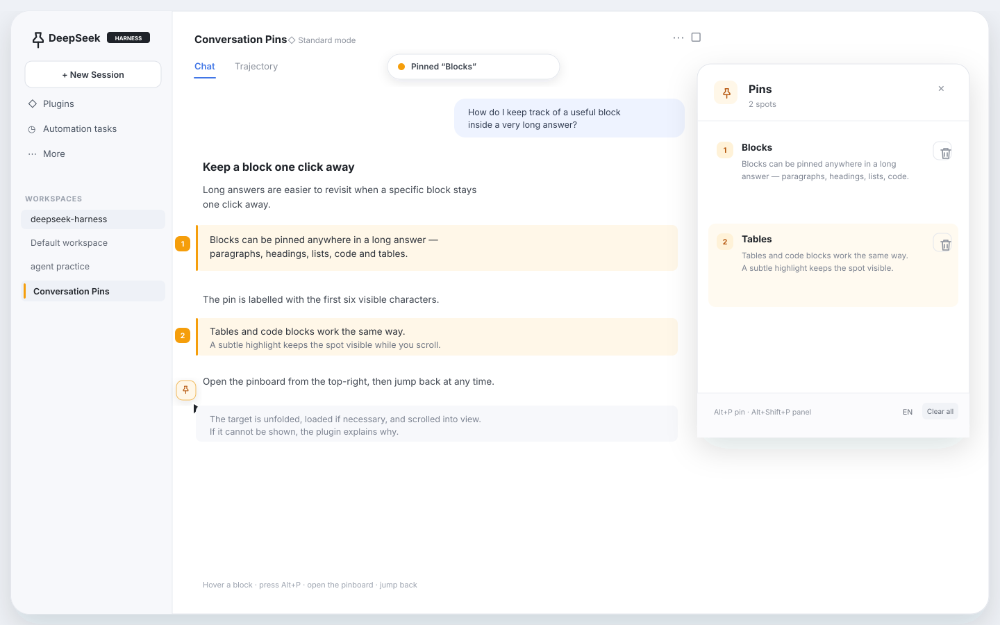
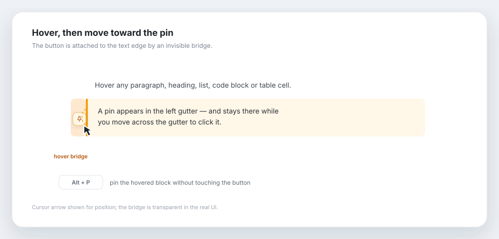
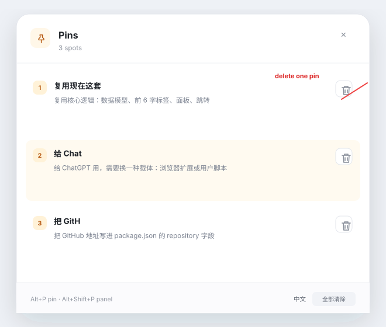
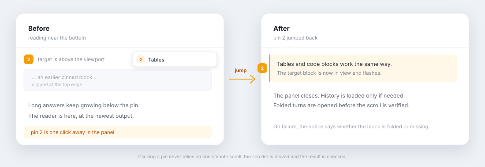

# Conversation Pins · 对话图钉

[](https://github.com/yuanxiao2630/dsh-conversation-pins/actions/workflows/check.yml)
[](https://github.com/yuanxiao2630/dsh-conversation-pins/releases)
[](LICENSE)
[](https://github.com/yuanxiao2630/dsh-conversation-pins/actions/workflows/pages.yml)

[English](README.md) | 简体中文

在 DeepSeek Harness 对话的任意输出块上打图钉，之后一键跳回。对话再长，也不用靠滚轮一点点找。

这是一个 **DSH Web / Desktop 客户端插件**：在消息流旁加图钉按钮、编号标记和每个会话独立的图钉面板。它不是 ChatGPT 插件，也不能直接装进 ChatGPT 的消息流。

## 示例



**悬停后移向图钉**



**图钉面板与单条删除**



**从长回答底部跳回图钉**



*点击图钉会直接移动会话滚动容器，必要时展开折叠内容，并校验目标确实进入可视区。*

*示例图使用合成内容。实际界面会跟随 DSH 当前主题和语言。*

## 功能

- **任意块可钉**：段落、标题、列表项、引用、代码块、表格单元格。
- **移向图钉不会消失**：按钮与正文左边缘之间有透明过渡区，从文字移向按钮时保持显示。
- **快捷键打钉**：悬停某段输出后按 `Alt + P` 直接打钉；`Alt + Shift + P` 开关面板。
- **前 6 个字符标签**：按可见文本计算，支持中文和 emoji 的完整字素截断。
- **编号图钉**：已固定位置在正文左侧显示编号，正文有淡琥珀色高亮。
- **单条删除**：图钉面板每行右侧都有删除按钮，和“全部清除”分开。
- **长对话跳回**：优先使用当前已加载的 DOM，必要时才加载历史；能展开折叠的轮次；滚动后会校验目标是否真正进入可视区，被流式渲染打断时用即时滚动校正。
- **每个会话独立**：按 `sessionId` 存进 `localStorage`，切换会话不会串。
- **中英双语**：跟随 DSH 语言，也可以在面板底部手动切换。

## 环境要求

- DeepSeek Harness `>=0.2.0 <0.3.0`，Web 或 Desktop profile。
- 目前只支持 Chat 视图，Trajectory 视图暂不支持。

## 安装

### Desktop 应用

Desktop profile 由 Electron 应用独占管理，不要使用 `dsh plugin --profile desktop`。

1. 打开 **Plugins → Add plugin**。
2. 填入本仓库的本地路径、tarball，或发布后的 GitHub 地址。
3. 点击 **Install**，再点 **Enable now**。
4. 完全退出 DeepSeek Harness，重新打开。

### Web / CLI

```sh
# 本地目录
dsh plugin --profile web add /path/to/dsh-conversation-pins

# 或 tarball
pnpm pack
dsh plugin --profile web add ./dsh-conversation-pins-0.1.4.tgz
```

安装后重启 `dsh web`。确认安装层：

```sh
dsh --profile web --dump-config | grep -A2 conversation-pins
```

卸载：

```sh
dsh plugin --profile web remove dsh-conversation-pins
```

`lib/` 已提交到仓库，所以从 GitHub 安装不需要构建：

```sh
dsh plugin --profile web add github:yuanxiao2630/dsh-conversation-pins
```

推送 `v0.1.3` 这样的 tag，release workflow 会构建并把 tarball 附到 GitHub Release。

### 通过插件索引安装

仓库发布了 format 1 插件索引：

```text
https://yuanxiao2630.github.io/dsh-conversation-pins/index.json
```

在 DSH 里启用实验性插件 **Custom plugin indexes**，打开 **Discover → Add index source**，粘贴上面的 URL。索引固定到准确的 release commit，不依赖会移动的 `main` 分支。

可读页面：[yuanxiao2630.github.io/dsh-conversation-pins](https://yuanxiao2630.github.io/dsh-conversation-pins/)。

## 使用

1. 鼠标移到一段输出上。
2. 点击左侧图钉，或按 `Alt + P`。
3. 继续阅读，或直接滚到对话最底部。
4. 点击右上角图钉按钮打开面板。
5. 点击任意图钉跳回；面板收起，目标闪烁高亮。

| 操作 | 快捷键 |
| --- | --- |
| 固定当前悬停的块 | `Alt + P` |
| 打开 / 关闭图钉面板 | `Alt + Shift + P` |
| 关闭图钉面板 | `Esc` |
| 跳转到图钉 | 点击面板条目或左侧编号 |

图钉只保存在当前浏览器；清理站点数据会一并清除。存储键为 `dsh:conversation-pins:v1:<sessionId>` 和 `dsh:conversation-pins:language`。

## 跳转逻辑

每个图钉保存会话节点 key、块序号、文本前缀、所属轮次和节点 anchor seq。跳转时先找当前已渲染的 DOM，只有找不到才调用 `Session.loadThrough(anchorSeq)` 加载历史。随后直接滚动会话容器，校验目标是否进入可视区；如果平滑滚动被流式渲染打断，会用即时滚动校正。目标在折叠的轮次或过程组里时，会先尝试展开对应 disclosure；仍然不可见时，会明确提示是“被折叠”还是“找不到”，而不是静默失败。

## 边界

- 只支持 Chat 视图，Trajectory 视图没有图钉。
- 锚点是 DOM + 文本；如果上游整块替换内容，会退化为块序号 + 文本前缀，可能定位到邻近块。
- ChatGPT / Claude 的网页不开放往消息流注入控件的接口，本仓库是 DSH 专用。
- 图钉不会跨浏览器或跨机器同步。

## 开发

```sh
pnpm install
pnpm build       # 重新生成 lib/client.js
pnpm check       # 检查已提交产物的语法
```

`lib/client.js` 是构建产物，并且有意提交到仓库，这样 `dsh plugin add <git-url>` 不需要在用户机器上执行构建。改源码后要重新构建并一起提交；CI 会重新构建并检查提交的 bundle 是否最新。

不安装进 profile 的临时 overlay：

```yaml
- insert:
    - id: conversation-pins-dev
      name: /absolute/path/to/dsh-conversation-pins/lib/index.js
```

```sh
dsh web --patch /absolute/path/to/pins.overlay.yml
```

### 目录结构

```text
dsh-conversation-pins/
├── package.json          # dsh.bundle + dsh.client 声明
├── cordis.patch.yml      # 向 profile 插入插件行
├── lib/
│   ├── index.js          # Host 半侧，空实现
│   └── client.js         # 浏览器 bundle（构建产物）
├── src/client.tsx        # overlay、锚点、图钉面板、跳转
├── build.mjs             # esbuild 构建脚本
├── pnpm-lock.yaml
└── README.md
```

## License

MIT，见 [LICENSE](LICENSE)。
